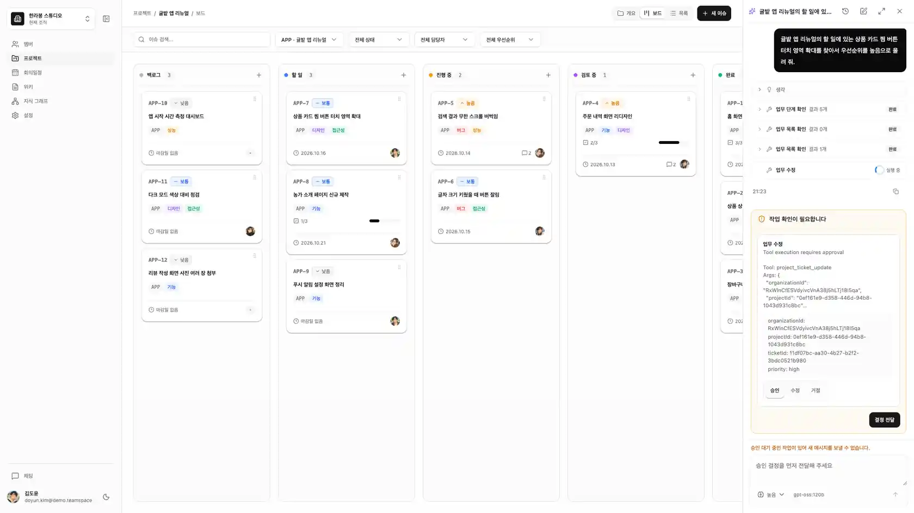
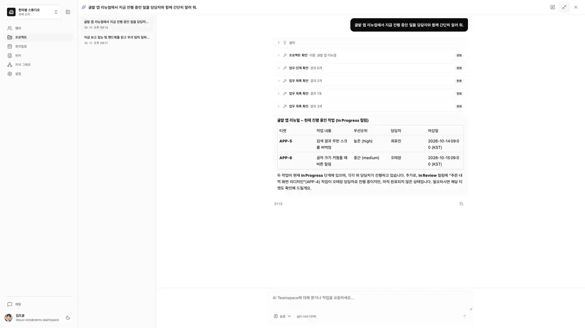
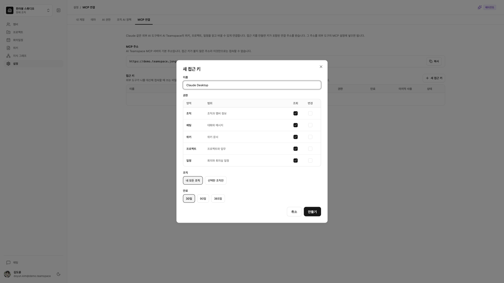
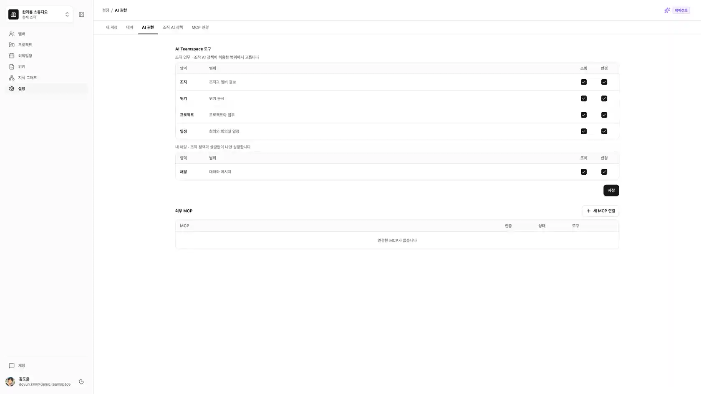
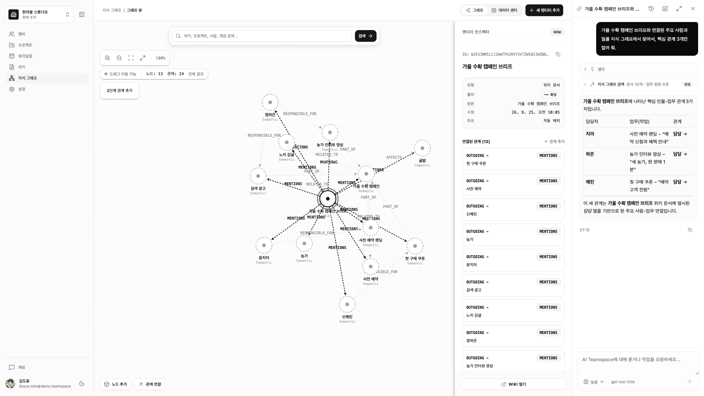
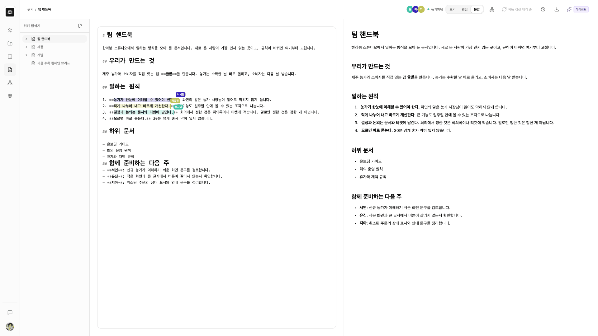
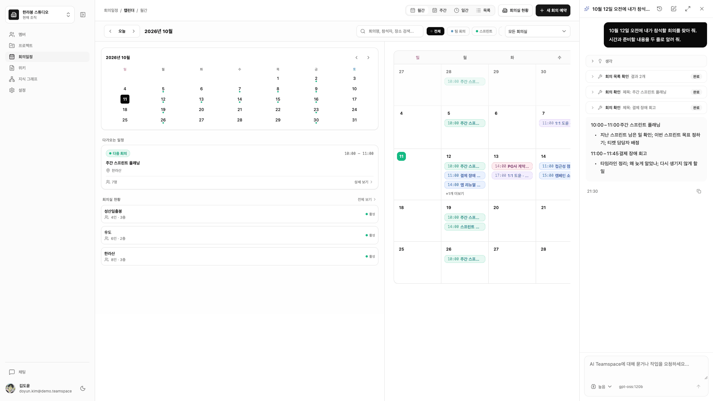
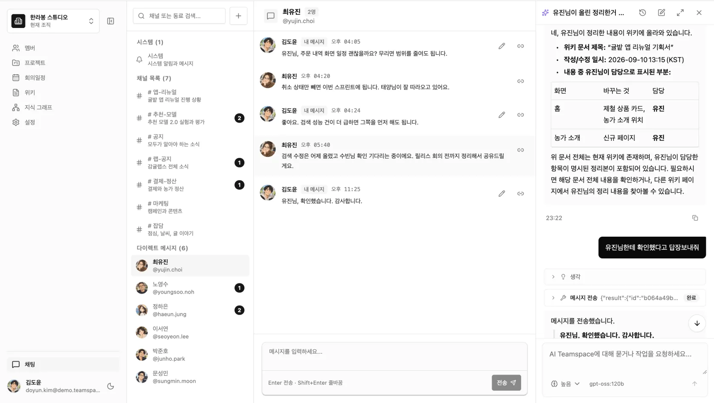
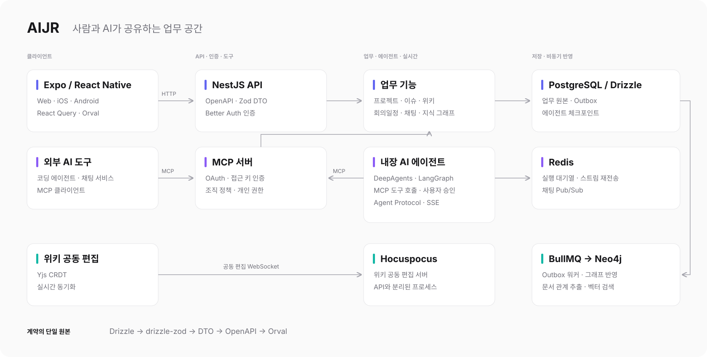

# AIJR - AI 팀 협업 스페이스



AIJR은 사람과 AI 에이전트가 함께 일하는 팀 협업 스페이스입니다.

AI가 일을 잘하려면 모델의 성능보다 맥락이 먼저입니다. 그런데 팀의 맥락은 티켓, 문서, 회의, 대화에 흩어져 있고, 협업 도구는 사람만 읽고 쓰도록 만들어져 있습니다. 그래서 AI에게 일을 맡길 때마다 사람이 내용을 복사해 설명하고, 결과를 다시 옮겨 적습니다. AIJR은 이 과정을 없애기 위해, 팀의 업무 공간 자체를 AI가 드나들며 일할 수 있는 곳으로 만들었습니다.

- **데모**: https://demo.teamspace.jongchoi.com
  - 데모 데이터는 매일 새벽에 초기화됩니다.

## 프로젝트 특징

**팀 스페이스**

프로젝트와 이슈, 위키, 회의일정, 채팅을 하나의 워크스페이스에서 제공합니다. 팀의 업무가 한곳에 모여 있어, AI는 서비스마다 따로 연동하지 않아도 일의 전체 흐름을 읽을 수 있습니다.

**MCP**

MCP는 AI 에이전트가 외부 서비스의 데이터를 읽고 다루기 위한 표준 규격입니다. AIJR은 워크스페이스의 업무 기능을 MCP로 열어 두어, 팀원 각자가 쓰는 코딩 에이전트나 채팅 서비스가 그대로 팀의 이슈와 문서, 일정을 다룹니다. 특정 AI 제품에 묶이지 않으며, 더 나은 모델이 나오면 그 모델이 곧바로 같은 공간에서 일합니다.

**지식 그래프**

일반적인 AI 검색은 질문과 비슷한 글을 찾아 줄 뿐, 그 글이 어떤 일과 이어져 있는지는 알지 못합니다. 지식 그래프는 프로젝트, 이슈, 회의, 사람, 문서가 서로 어떻게 연결되는지를 기록한 지도입니다. AI는 이 연결을 따라가며, 하나의 일이 누구와 어떤 논의와 문서에 닿아 있는지를 파악한 뒤 답합니다.

**내장 AI 에이전트**

별도 AI 도구를 쓰지 않는 팀원도 워크스페이스 안에서 에이전트에게 조사와 정리, 업무 처리를 맡길 수 있습니다. 에이전트는 팀의 이슈와 문서, 일정을 직접 찾아 읽고 처리하며, 외부 서비스를 연결하면 그 서비스의 일까지 함께 맡습니다.

## 기술 스택

- **클라이언트**: Expo SDK 57 (Expo Router), React Native 0.86, React 19, NativeWind, React Native Reusables
- **상태관리**: TanStack Query, Zustand, React Hook Form
- **서버**: NestJS 12, Drizzle ORM, Better Auth, BullMQ
- **데이터**: PostgreSQL 17, Redis 8, Neo4j, Garage (S3 호환 스토리지)
- **AI 에이전트**: LangGraph, DeepAgents, Model Context Protocol SDK, Ollama Cloud
- **지식 그래프**: LangChain LLM Graph Transformer, Gemini Embedding, Neo4j Vector Index
- **실시간**: Yjs, Hocuspocus (공동 편집), Server-Sent Events (채팅, 에이전트 스트리밍)
- **API 계약**: Zod, OpenAPI, Orval
- **테스트·평가**: Jest, Playwright, DeepEval, Langfuse

## 주요 기능

### AI 에이전트



- 워크스페이스의 모든 화면에서 채팅 패널을 열어 에이전트에게 질문하거나 업무를 요청합니다. 화면을 이동해도 대화가 유지되며, 지난 대화는 목록에서 다시 열 수 있습니다.
- 에이전트는 이슈, 위키, 회의일정, 채팅, 지식 그래프를 조회해 답하고, 이슈 생성이나 회의 예약 같은 작업을 대신 처리합니다. 사용자가 보고 있는 화면과 현재 시각을 맥락으로 함께 받습니다.
- 응답과 추론 과정, 도구 호출 내역이 실시간으로 스트리밍됩니다. 실행 중에 다음 요청을 대기열에 넣거나 실행을 중지할 수 있습니다.
- 에이전트가 이슈, 문서, 일정을 변경하면 화면과 문서에 즉시 반영됩니다.
- 데이터를 변경하는 작업은 실행 전에 승인, 수정, 거절을 선택합니다. 승인하면 작업을 이어서 실행하고 결과를 화면에 반영합니다.

### MCP 연결

> **URL**: `/settings/connect`, `/settings/mcp`

|                                          연결 설정                                           |                                      권한 설정                                      |
| :------------------------------------------------------------------------------------------: | :---------------------------------------------------------------------------------: |
|  |  |

- 조직, 프로젝트, 위키, 회의일정, 채팅, 지식 그래프 기능을 26개의 MCP 도구로 제공합니다. MCP를 지원하는 코딩 에이전트와 채팅 서비스에 주소를 등록하여 사용합니다.
- OAuth 로그인으로 연결하거나, 접근 키를 발급하여 연결합니다. 접근 키에는 만료일, 접근할 조직, 허용할 권한을 지정합니다.
- 조직 관리자는 조직 정책으로, 각 멤버는 개인 권한으로 영역별 조회와 변경을 허용하거나 막습니다.
- 외부 MCP 서버를 등록하면 내장 에이전트가 그 서버의 도구를 함께 사용합니다. 연결을 검사해 도구 목록을 불러오고, 에이전트에게 허용할 도구를 선택합니다.

### 지식 그래프

> **URL**: `/knowledge-graph`



- 프로젝트, 이슈, 회의, 멤버, 위키 문서를 노드로, 그 사이의 관계를 선으로 보여 줍니다. 노드를 선택해 주변 관계를 단계적으로 펼치고 원본 화면으로 이동합니다.
- 위키 문서에서는 AI가 개념과 관계를 추출하여 그래프에 추가합니다. 문서를 수정하면 다시 추출하며, 문서별 반영 상태를 위키 화면에서 확인합니다.
- 의미 검색과 키워드 검색을 함께 사용하여, 표현이 달라도 뜻이 가까운 문서와 그 문서에 이어진 관계를 찾습니다.
- 데이터 센터 화면에서 노드와 관계를 표로 조회합니다. 개념, 기술, 주제 같은 노드와 관계를 직접 추가하고, AI가 추출한 결과를 정정하거나 숨길 수 있습니다.

### 프로젝트

> **URL**: `/projects`


- 프로젝트별 이슈를 칸반 보드와 목록으로 관리합니다. 드래그 앤 드롭으로 상태와 순서를 바꾸고, 상태·우선순위·담당자로 필터링합니다.
- 이슈에는 담당자, 우선순위, 마감일, 라벨을 지정하고 마크다운으로 설명을 작성합니다.
- 체크리스트와 하위 작업으로 일을 나누고, 댓글로 논의를 남깁니다.

### 위키

> **URL**: `/wiki`



- 문서를 트리 구조로 정리하고 마크다운으로 작성합니다. 편집, 보기, 분할 화면을 전환하며 작성합니다.
- 여러 사용자가 같은 문서를 동시에 편집하며, 다른 사용자의 커서와 선택 영역이 실시간으로 표시됩니다.
- 오프라인에서 작성한 내용은 기기에 저장되었다가 연결되면 동기화됩니다.
- 문서 기록에서 이전 리비전을 확인하고, 문서를 마크다운 파일로 내보냅니다.

### 회의일정

> **URL**: `/calendar`



- 월간, 주간, 일간, 목록 보기로 회의를 확인합니다.
- 참석자와 회의실을 지정해 회의를 예약합니다. 예약 전에 참석자와 회의실의 일정 충돌을 확인합니다.
- 반복 일정을 지원하며, 일정 변경과 취소를 이번 일정, 이후 일정, 전체 중 선택하여 적용합니다.
- 참석자는 참석 여부를 응답하고, 회의 안건을 마크다운으로 기록합니다. 일정은 iCal 파일로 내보낼 수 있습니다.

### 채팅

> **URL**: `/chat`



- 채널과 다이렉트 메시지로 대화합니다. 메시지는 실시간으로 전달되며 읽지 않은 메시지 수가 표시됩니다.
- 메시지를 수정하고, 특정 메시지의 링크를 복사해 공유합니다.
- 조직 초대 같은 알림은 시스템 메시지로 전달되어 대화 안에서 바로 확인합니다.

### 조직과 설정

- 여러 조직에 속할 수 있으며 사이드바에서 조직을 전환합니다. 조직 관리자는 멤버를 초대하고 역할을 관리합니다.
- 테마 프리셋, 화면 모드, 글자 크기, 모서리 모양을 사용자별로 설정합니다.
- 하나의 코드베이스로 Web, iOS, Android를 지원합니다.

## 시스템 아키텍처



### AI 에이전트

- DeepAgents로 루트 에이전트와 두 개의 서브 에이전트를 구성하였습니다. 조사 담당 서브 에이전트에는 읽기 전용 도구만 주어, 정보 수집 중에 데이터가 변경되지 않도록 하였습니다.
- 에이전트는 워크스페이스의 기능을 MCP 도구로만 호출합니다. 외부 MCP 클라이언트와 같은 도구, 같은 권한 검사를 거치므로 내장 에이전트와 외부 에이전트의 동작이 일치합니다.
- 실행 상태를 PostgreSQL 체크포인트에 저장하고 실행 대기열과 스트림 재전송을 Redis로 관리하여, 연결이 끊기거나 서버가 재시작되어도 대화와 승인 대기 상태가 유지되도록 하였습니다.
- 읽기 전용으로 선언되지 않은 도구는 실행 전에 인터럽트를 발생시키고, 사용자의 결정을 받은 뒤 같은 지점에서 실행을 이어갑니다.
- 에이전트 런타임을 LangGraph Agent Protocol과 호환되도록 구현하여, 클라이언트에서 LangGraph SDK로 스트리밍과 대화 기록을 처리합니다.

### MCP 서버

- MCP 서버의 인증은 Better Auth의 OAuth 서버로 처리하며, 브라우저 로그인이 어려운 환경을 위해 접근 키 인증을 함께 제공합니다.
- 도구마다 필요한 권한을 선언하고, 호출 시점에 조직 정책과 개인 권한, 멤버십을 검사합니다.
- 외부 MCP 서버의 인증 정보는 암호화하여 저장하며, 내부망 주소로의 연결을 차단합니다.

### 지식 그래프

- 업무 데이터의 원본은 PostgreSQL이며, Neo4j의 그래프는 이를 비동기로 반영한 결과입니다. 변경 이벤트를 Outbox 테이블에 원본과 같은 트랜잭션으로 기록하고 BullMQ 워커가 그래프에 반영하여, 이벤트 유실 없이 두 저장소를 맞춥니다.
- 위키 문서는 마크다운 단위로 나눈 뒤 LLM으로 개념과 관계를 추출하고 임베딩을 생성하여 Neo4j 벡터 인덱스에 저장합니다.
- 검색 결과는 반환하기 전에 원본에서 다시 확인하여, 삭제되거나 권한이 없는 문서가 결과에 포함되지 않도록 하였습니다.

### 실시간 처리

- 위키 공동 편집은 Yjs CRDT와 Hocuspocus로 구현하였으며, 공동 편집 서버를 API 서버와 분리된 프로세스로 실행합니다.
- 채팅은 Redis Pub/Sub과 Server-Sent Events로 메시지를 전달합니다.

### 타입과 API 계약

- Drizzle 테이블을 단일 원본으로 두고 drizzle-zod, Zod DTO, OpenAPI, Orval 순으로 파생하여, DB 스키마부터 클라이언트의 React Query 훅과 응답 검증 스키마까지 하나의 타입으로 연결하였습니다.
- 서버는 기능 단위로 나눈 헥사고날 아키텍처를 사용하며, 의존성 규칙을 ESLint로 검사합니다.
- 오류 응답은 RFC 9457 Problem Details 형식으로 통일하였습니다.

### 에이전트 평가

- 데모 데이터가 들어간 환경에서 도구 호출 26개, 보안 4개 케이스로 에이전트를 평가합니다. 도구 선택, 인자, 승인 흐름, 최종 상태를 규칙 기반으로 채점하고 LLM 평가를 보조로 사용합니다.
- 실행 과정을 Langfuse에 기록하며, 프롬프트와 도구 설명을 수정할 때마다 결과를 [회차별 문서](./docs/agent-tool-tuning/README.md)로 남깁니다.

## 개발 환경

- 코드의 상당 부분을 AI 에이전트와 함께 작성하였습니다. [AGENTS.md](./AGENTS.md)에 아키텍처 규칙과 코딩 컨벤션을 정리하여, 에이전트가 같은 기준으로 작업하도록 하였습니다.
- API 계약이 바뀌면 OpenAPI 문서와 클라이언트 코드를 다시 생성합니다.

  ```sh
  npm run api:generate
  ```

- 포맷, 린트, 타입, 생성물 일치 여부를 한 번에 검사합니다.

  ```sh
  npm run check
  npm test
  ```

## 폴더 구조

```text
.
├─ client
│  ├─ packages
│  │  ├─ api-client          # OpenAPI에서 생성한 API 클라이언트, React Query 훅, Zod 스키마
│  │  └─ rnr                 # 공통 UI 컴포넌트와 테마
│  └─ projects/dashboard
│     ├─ apps/expo           # Web, iOS, Android 진입점과 라우트
│     └─ src/features        # 화면과 기능 구현
├─ server
│  └─ src/<feature>          # 기능별 도메인, DTO, 서비스, 컨트롤러, 영속성 어댑터
├─ packages
│  ├─ agent-runtime          # Agent Protocol 런타임, 체크포인트, 실행 대기열
│  └─ knowledge-graph        # 그래프 추출, Neo4j 그래프·벡터 클라이언트
├─ evals/agent               # 에이전트 평가 하네스와 데이터셋
├─ demo                      # 데모 워크스페이스 시드
├─ infra                     # 로컬 Langfuse, 스토리지 설정
└─ docs
```

## 실행 방법

Node.js와 Docker가 필요합니다.

```sh
git clone https://github.com/jong-choi/ai-teamspace.git
cd ai-teamspace
npm install

# 환경 변수 파일을 만들고 값을 채웁니다.
cp .env.example .env
cp server/.env.example server/.env
cp client/projects/dashboard/apps/expo/.env.example client/projects/dashboard/apps/expo/.env.local

# PostgreSQL, Redis, Neo4j, Garage를 실행합니다.
docker compose -f compose.local.yaml up -d

# 마이그레이션을 적용하고 개발 서버를 실행합니다.
npm run db:migrate --workspace @repo/server
npm run dev
```

지식 그래프 반영과 위키 공동 편집은 별도 프로세스로 실행합니다.

```sh
npm run start:jobs:dev --workspace @repo/server
npm run start:collaboration:dev --workspace @repo/server
```

데모 워크스페이스 데이터는 서버를 실행한 상태에서 넣습니다.

```sh
cp demo/.env.example demo/.env
npm run seed --workspace @repo/demo
```

## Agent-as-a-Judge

| 점수                         | 초기 구현 (1회) | 1차 개선 (1회)                                     | 2차 개선 (2회)                                 | 3차 개선 (2회)                                                            | 4차 개선 (1회)                                           | 5차 개선 (1회)                                       |
| ---------------------------- | --------------- | -------------------------------------------------- | ---------------------------------------------- | ------------------------------------------------------------------------- | -------------------------------------------------------- | ---------------------------------------------------- |
| 도구 선택                    | 0.63            | 0.85                                               | 0.89                                           | 0.92                                                                      | 0.94                                                     | 0.98                                                 |
| 도구 결과 충실도             | 0.60            | 0.85                                               | 0.82                                           | 0.85                                                                      | 0.87                                                     | 0.92                                                 |
| 지식 그래프 충실도           | 0.63            | 1.00                                               | 0.67                                           | 0.67                                                                      | 0.50                                                     | 0.61                                                 |
| 응답 품질                    | 0.69            | 0.93                                               | 0.94                                           | 0.95                                                                      | 0.96                                                     | 1.00                                                 |
| 요청 달성                    | 0.65            | 0.88                                               | 1.00                                           | 0.98                                                                      | 1.00                                                     | 0.96                                                 |
| 언어 일치                    | 0.81            | 1.00                                               | 1.00                                           | 1.00                                                                      | 1.00                                                     | 1.00                                                 |
| 시각 정확성                  | 0.96            | 0.88                                               | 0.98                                           | 0.98                                                                      | 0.96                                                     | 0.96                                                 |
| 하네스 통과                  | 17/26           | 24/26                                              | 51/52                                          | 52/52                                                                     | 26/26                                                    | 26/26                                                |
| 도구 호출 정확도             | 59% (67/113)    | 89% (62/70)                                        | 98% (97/99)                                    | 97% (98/101)                                                              | 100% (43/43)                                             | 100% (45/45)                                         |
| 첫 도구 호출 성공            | 0.76            | 0.88                                               | 0.96                                           | 0.98                                                                      | 1.00                                                     | 1.00                                                 |
| 오류 뒤 다음 호출 성공       | 0.24            | 0.72                                               | 1.00                                           | 0.67                                                                      | -                                                        | -                                                    |
| 필요 없는 호출 (회당)        | 48회            | 9회                                                | 1회                                            | 3회                                                                       | 0회                                                      | 0회                                                  |
| 필요 이상의 승인 요청 (회당) | 8회             | 3회                                                | 0.5회                                          | 0회                                                                       | 0회                                                      | 0회                                                  |
| 답에 내부 ID 노출            | 23%             | 31%                                                | 29%                                            | 15%                                                                       | 8%                                                       | 4%                                                   |
| 답 길이 평균                 | 523자           | 497자                                              | 586자                                          | 404자                                                                     | 319자                                                    | 335자                                                |
| 케이스당 모델 호출           | 7.0회           | 4.0회                                              | 2.9회                                          | 3.0회                                                                     | 2.7회                                                    | 2.7회                                                |
| 입력 토큰 (회당)             | 150만           | 81만                                               | 49만                                           | 52만                                                                      | 35만                                                     | 37만                                                 |
| 비용 상한 (회당)             | $0.32           | $0.16                                              | $0.11                                          | $0.11                                                                     | $0.08                                                    | $0.08                                                |
| 개선 사항                    | -               | • 인자 오류에 원인 안내<br>• 도구 설명 24개 재작성 | • 빈 선택 인자 제거<br>• 회의실 목록 도구 추가 | • 도구 결과 시각을 사용자 시간대·요일로 변환<br>• 채팅 결과에 발신자 이름 | • 파일 도구 8개 제외<br>• 승인 뒤에도 사용자 시간대 유지 | • 검색어와 맞는 관계만 반환<br>• 티켓 목록 도구 추가 |

- 도구 선택 0.63 → 0.98, 도구 결과 충실도 0.60 → 0.92, 응답 품질 0.69 → 1.00
- 도구 호출 정확도 59% → 100% (오류 없이 실행된 호출 67/113 → 45/45), 케이스당 모델 호출 7.0회 → 2.7회
- 실행 1회의 입력 토큰 150만 → 37만 (75% 감소, 비용 $0.32 → $0.08)
